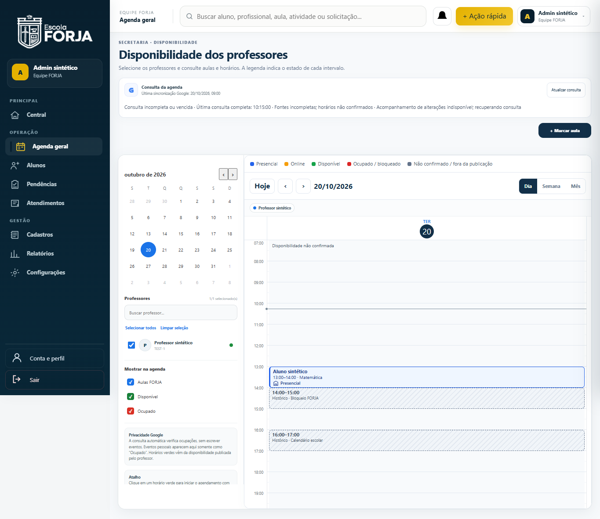
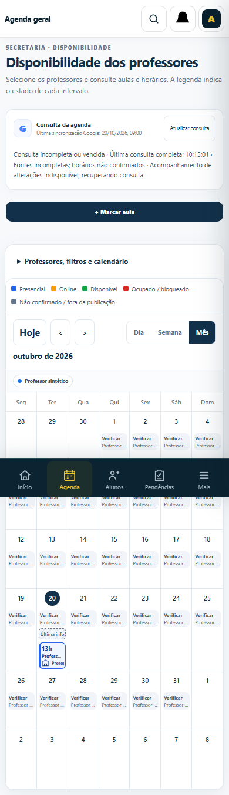
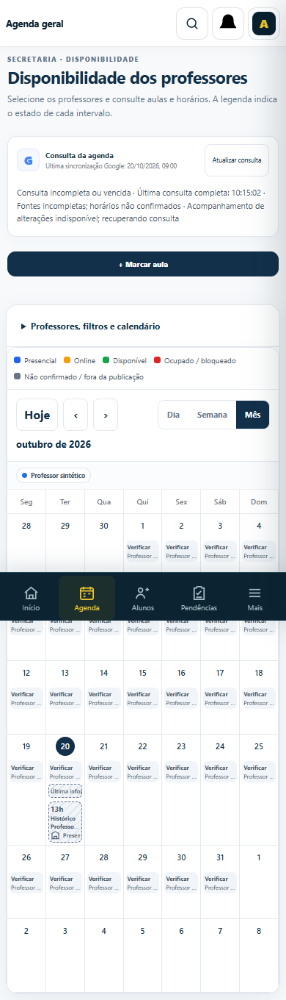
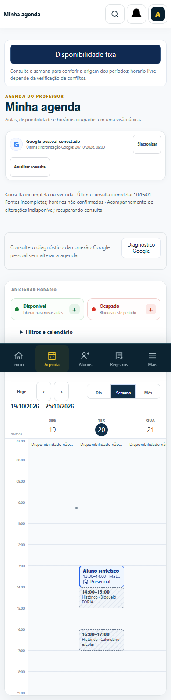
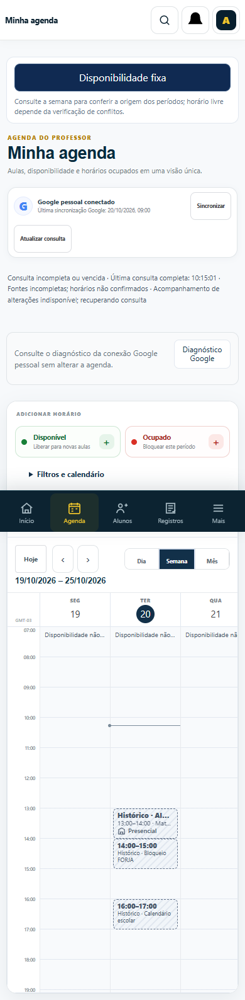
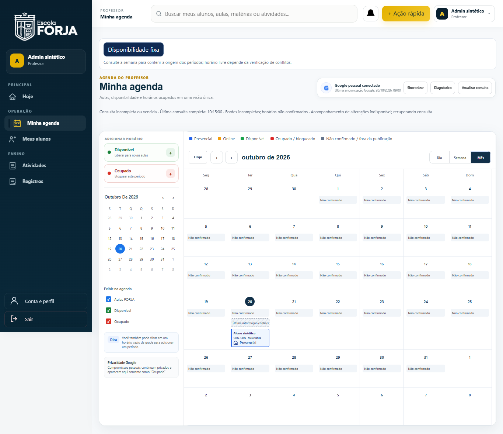

# Aulas nativas: antes/depois com dados sintéticos

Portal real com a fixture existente `agenda-presentation-fixture.mjs`, Firebase e
Google simulados na borda. Nenhuma conta, aula ou calendário real. Capturas antes:
head `b37580b`; depois: fonte HTML SHA256
`6bee41d5aba0dda2213077a2830c3cc5b451e9f9d6ede35f0d458f0a6e43c179`.

O cenário parte de uma consulta confirmada e depois torna a fonte nativa
indisponível. Antes, a aula retida conservava a aparência de aula confirmada.
Depois, fica cinza tracejada com “Histórico” visível e nome acessível completo
“Última informação conhecida · Aula não confirmada”, mantendo modalidade e horário.
Nenhum horário desconhecido pode ser reservado. O detalhe consulta a aula canônica
antes de oferecer ações. A falha apenas Google não retira a confirmação nativa.

Desktop1365px; mobile390px. A suíte também verifica360px, Dia/Semana/Mês,
expiração durante consulta, recuperação e cancelamentos. Na semana mobile, a
rolagem interna da grade continua intencional; não há overflow da página.
A barra inferior fixa pode aparecer no meio da captura de página inteira.

| Cenário | Antes | Depois |
| --- | --- | --- |
| Secretaria, Dia desktop |  |  |
| Secretaria, Mês mobile |  |  |
| Professor, Semana mobile |  |  |
| Professor, Mês desktop |  |  |
