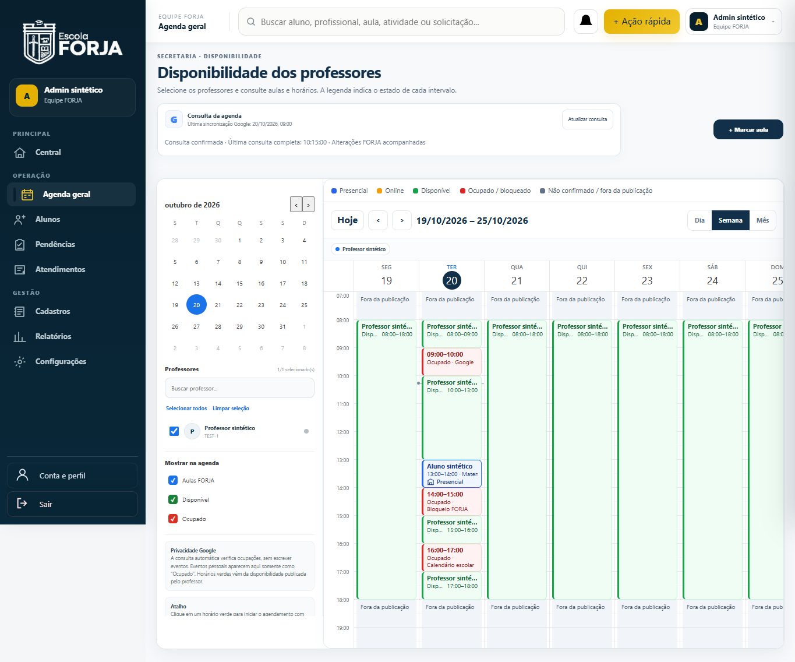
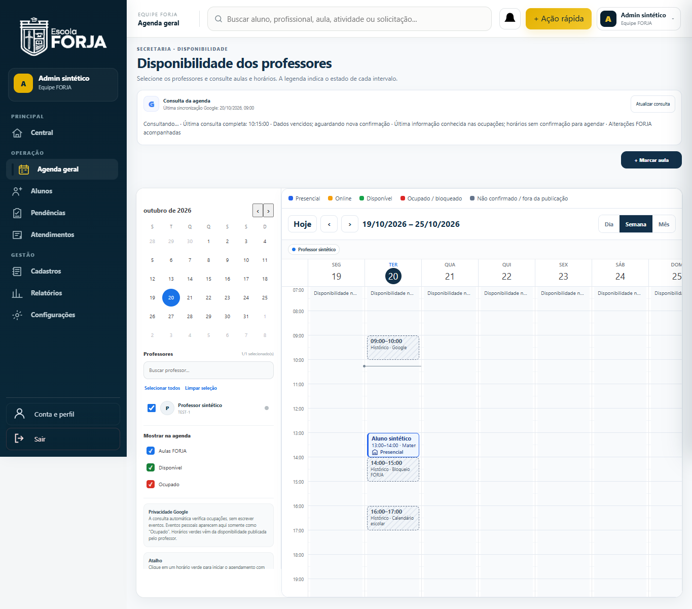

# Agenda — evidências fictícias de antes/depois

Antes: main4714295. Depois: correção local, HTML SHA256
ba74193627434d2da4be99d3fafb8718a8ae301659023f621992845f98a07c51.
Chrome/Playwright, portal real com providers simulados. Nenhuma conta escolar.

| Cenário | Antes | Depois |
|---|---|---|
| SSE ready sem mudança | [captura](before-ready-admin.png) | [captura](after-ready-admin.png) |
| Snapshot expirado durante renovação | [captura](before-expired-admin.png) | [captura](after-expired-admin.png) |
| ADM1366px, Dia, ocupações sobrepostas e curtas | [captura](before-admin-1366-day.png) | [captura](after-admin-1366-day.png) |
| ADM360px, Semana | [captura](before-admin-360-week.png) | [captura](after-admin-360-week.png) |
| Professor390px, Dia | [captura](before-teacher-390-day.png) | [captura](after-teacher-390-day.png) |
| ADM1920px, Mês | [captura](before-admin-1920-month.png) | [captura](after-admin-1920-month.png) |

Capturas completas podem mostrar a barra fixa de navegação no ponto do viewport
usado pelo navegador. A grade semanal tem scroll interno intencional; não há
scroll horizontal da página. Cartões mensais são resumos; o dia nativo preserva
o detalhamento. Nomes/horários completos ficam acessíveis sem títulos Google.

